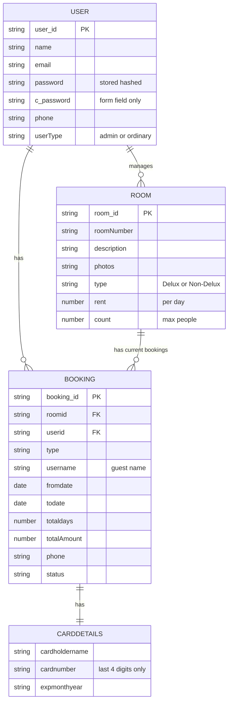

# ER Diagram - Hotel / Room Booking System

## 1. Entities and their attributes

### User
| Attribute | Meaning |
|---|---|
| user_id | Unique id (`_id` in MongoDB) |
| name | Full name |
| email | Login email (unique) |
| password | Login password, saved only in hashed form (bcrypt) |
| c_password | Confirm-password box on the signup form. It is compared with `password` and never saved |
| phone | Contact number (10 digits) |
| userType | `admin` or `ordinary` (customer) |

**Relationship:** A user can make bookings and is linked to rooms (an admin manages rooms).

### Room
| Attribute | Meaning |
|---|---|
| room_id | Unique id (`_id` in MongoDB) |
| roomNumber | Room number (unique) |
| description | Short description |
| photos | List of image links |
| type | Delux or Non-Delux |
| rent | Price of the room per day |
| count | Maximum number of people the room holds |

**Relationship:** A room has current bookings (fromdate, todate, status, booking_id, user_id). In HotelPro these are the bookings of that room whose status is `booked` or `checked-in`, found through the Booking collection.

### Booking
| Attribute | Meaning |
|---|---|
| booking_id | Unique id (`_id` in MongoDB) |
| roomid | The room that is booked |
| userid | The user who booked |
| type | Room type at the time of booking |
| username | Guest name |
| fromdate | Arrival date |
| todate | Departure date |
| totaldays | Number of nights |
| totalAmount | totaldays multiplied by the room rent |
| phone | Guest phone number |
| status | booked, checked-in, checked-out or cancelled |
| cardDetails | Payment info (see next table), stored inside the booking |

**Relationship:** A booking is linked to one user and one room.

### CardDetails (payment info)
| Attribute | Meaning |
|---|---|
| cardholdername | Name on the card |
| cardnumber | Only the last four digits are kept (`**** **** **** 1234`) |
| expmonthyear | Card expiry (MM/YY) |
| cvvcode | Entered by the guest while paying, checked, and **never stored** |

**Relationship:** Linked to a booking (payment processing).

**Security note:** Card rules (PCI DSS) forbid saving the CVV code, and full card numbers should only be kept by a certified payment provider. The payment step in HotelPro is a simulation and charges no money.

## 2. Relationships

- User "has" Booking: one user can create many bookings.
- User "has" Room: a user such as the admin or owner may manage many rooms.
- Booking "has" CardDetails: each booking has its payment details.
- Room "has" CurrentBookings: tracks the active reservations of that room. The system uses these so two bookings of the same room never overlap in dates (`Server/utils/availability.js`).
