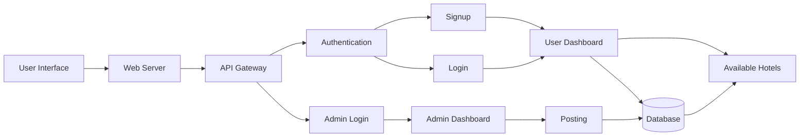

# Technical Architecture

## In this technical architecture, HotelPro consists of several components

- **User Interface:** The React pages (`Client/src/pages`) where a visitor chooses to sign up or log in, and where a guest searches and books rooms.
- **Web Server:** Serves the React application to the browser (the Vite server in development).
- **API Gateway:** The Express server (`Server/server.js`) is the single entry point for both guest and admin requests. Every request starts with `/api` and is sent through `Server/Routes/` to the matching controller.
- **Authentication:** Signup saves the new user (name, email, phone, user type) in the `users` collection with a hashed password; signing up as admin needs a secret admin code. Login checks the password and returns a JWT (JSON Web Token). The `protect` and `adminOnly` middleware (`Server/middleware/auth.js`) check the token and the role on every protected route.
- **Signup and Login:** Both lead to the User Dashboard once they succeed.
- **User Dashboard:** The user searches by dates, people and room type, books and pays for rooms (simulated payment) and manages bookings (`UserHome`). Bookings are saved in the database.
- **Available Hotels:** The list of rooms that are free for the chosen dates, read from the database. Rooms already booked for those dates are filtered out using the date-overlap check in `Server/utils/availability.js`.
- **Admin Login:** The admin signs in through the same login form. The role stored on the user record (`admin`) is what opens the admin area.
- **Admin Dashboard:** `AdminHome` has the tabs All Bookings, All Rooms, Add Room and All Users, including check-in and check-out.
- **Posting:** The admin posts new rooms (and edits or deletes them). They are saved in the database and then appear to guests as available rooms.
- **Database:** MongoDB with three collections: `users`, `rooms` and `bookings`.
