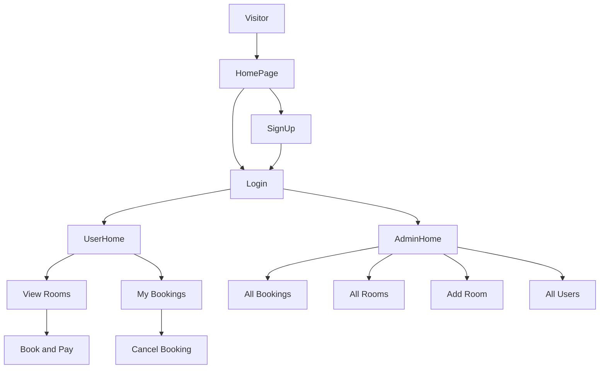

# User Flow

## 1. Landing / Home page
- **Visible to:** all visitors (not logged in)
- Navbar with Home, Login, SignUp; hero carousel; About section; rooms preview
- **Actions:** click Login or SignUp, browse rooms and About info

## 2. SignUp (registration)
- **Fields:** name, email, password, confirm password, phone, user type (ordinary or admin; admin also needs the admin code)
- **Validation:** all fields required, password must match confirm password
- **Outcome:** valid, then the account is created, an "Account created successfully" message appears and the user goes to Login. Invalid, then errors are shown and nothing is saved.

## 3. Login
- **Fields:** email, password
- **Outcome:** credentials are checked. On success the JWT token and user are saved in localStorage; admin goes to AdminHome, ordinary user goes to UserHome. On failure an error message is shown.

## 4. User dashboard (UserHome)
- Greeting with the user's name, navbar with Rooms, My Bookings and Logout
- Search rooms by dates, people and type
- **Actions:** view My Bookings, logout (clears localStorage and returns to Home)

## 5. Booking flow
- Choose arrival and departure dates and search; the list shows only rooms free on those dates
- Click Book now, enter the payment details, click Pay and book
- The booking is saved and appears in My Bookings

## 6. My Bookings
- Each booking shows booking ID, room type, from and to dates, total amount, phone and status (Active or Cancelled)
- Cancel button for active bookings

## 7. Admin dashboard (AdminHome)
- Tabs: All Bookings, All Rooms, Add Room, All Users
- Navbar with the admin's name and Logout

## 8. Logout
- Visible to any logged-in user. Removes the user from localStorage and returns to Home.
